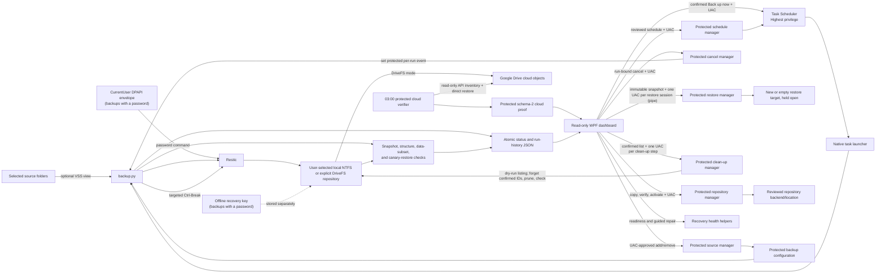

# Architecture

This document describes Rewindle v0.2.0-alpha.2 for Windows x64. Rewindle has
two parts: a backup engine (PowerShell managers and Python scripts that drive
Restic, run elevated by a scheduled task) and the Rewindle dashboard (a WPF
host with a WebView2 React interface that runs as the signed-in user). The
engine keeps its `ResticBackuper` executable, task, and protected-state
identifiers for compatibility with earlier alphas. Restic remains the
component that creates, encrypts, deduplicates, and restores repository
snapshots.

## The dashboard

`ResticBackuperDashboard.exe` is a WPF application that hosts the React
interface in Microsoft Edge WebView2. It runs with the user's standard rights
and refuses to start with an administrator token. Its role is limited to:

- reading the engine's protected configuration, status, run records, logs, and
  cloud proof (read-only; it never writes protected state and never reads the
  repository password);
- reading the installed backup task from Task Scheduler, including the time
  and result Windows recorded for its last run;
- running the read-only recovery-readiness check as the user; and
- requesting every change (folders, schedule, cancellation, repository
  location, restore, repairs, **Back up now**) from the engine's protected
  managers and helpers through UAC, then reading back and checking each result
  before reporting it.

The page is loaded from the bundled files through a local virtual host. The
host answers any other web request with an error, refuses navigation away from
that host, new windows, downloads, permission requests, and external URI
schemes, and disables developer tools. The page and the host exchange messages
over the WebView2 bridge, and the host accepts only allow-listed commands. The
commands that open a folder in File Explorer take no path from the page; the
host decides which folder to open.

The interface incorporates the literal Beautiful UI components pinned in
[`src/dashboard/web/vendor/UPSTREAM.md`](../src/dashboard/web/vendor/UPSTREAM.md),
including the navigation rail, task rows, filter table, insight cards, context
cards, loading states, and their source keyframes. Motion supplies page
transitions, staggered content, expandable-row feedback, and reduced-motion
handling. Liveline renders the activity trend without inventing backup state.
Animation is decorative: every status, snapshot, and action comes from the
native host. The sample data used for development and screenshots is reachable
only from the dev server and the demo build mode and is not in the shipped
bundle.

If the WebView2 renderer or browser process exits, the host reloads the page
automatically a bounded number of times before offering **Reload**; a page that
stops responding is given time before the user is asked to keep waiting or
reload. Scheduled backups run separately and are unaffected.

### Backup drive space

The Backup location card says how full the backup location is. The host reads
the free space and size of the location's drive root (`TotalFreeSpace`, the
number the engine's own free-space check compares with the reserve) off the
window's thread every minute, and sooner after **Refresh** and when a backup
ends; it never lists the backup folder. What the backups take comes from
`repository_bytes_after` in `last-success.json` (for Google Drive locations, the
engine's count before the run plus what the run saved, shown as "about"); the
reserve is `minimum_free_gib` from the plan. `BackupSpace.cs` is pure: it
forecasts from the run history the dashboard already keeps (what each verified
backup of the last 8 weeks saved, leaving out the single biggest one, at the
rate backups have run, anchored on the newest run rather than the clock) and
decides the level. Red: less free space than the reserve, so the next backup
would be refused. Amber: full within the person's **Low space warning** (4, 8
or 12 weeks, kept in `space-warning.json` in the dashboard's own per-user
folder, not protected configuration), less than 1.5 times the reserve (where
**Check recovery readiness** warns too, so the card is never calmer than it),
or, while the forecast is still learning, less than a tenth of the drive above
the reserve. Readiness can still say a drive has plenty of free space beside
an amber card: it looks at the space now, the card at the trend. While a backup
runs, the card keeps what it said before the run (its own writes may take the
free space below the reserve, which the engine checks only as a run starts).
Every sentence that asks the person to make room also says never to delete
anything inside the backup folder. The earlier personal edition records no
size, so with it the card shows the free space and the drive's size, says the
forecast isn't available with that backup program
(`EngineProfile.ForecastsBackupSpace`) and offers no Low space warning. It
keeps only the reserve rules: red below the reserve and amber below 1.5 times
it. The tenth-of-the-drive rule is left out there, since on a drive mostly full
of other files it would stay amber for good with nothing to tune. The forecast is
net growth: clean-up of old backups (below) is the only thing that takes data
out of the backup location, so the forecast takes away the space each clean-up
in those 8 weeks freed (the free space after it minus before it, from
`retention-history.json`). Backups that the person keeps at a steady size by
removing old ones are then flat, not filling the drive. A clean-up in those
weeks whose freed space was not measured leaves the forecast learning ("Old
backups were removed lately, so Rewindle needs up to 8 more weeks of backups to
tell when the drive will be full.") until it is 8 weeks back, and while the
clean-up records cannot be read there is no forecast at all: it never says
"full in N weeks" from what the backups added alone.

### Engine profiles

Every name the dashboard uses to find an engine, ask it for something, and
trust its answer is owned by one class, `src/dashboard/EngineProfile.cs`:
install and state roots, scheduled tasks, the task launcher, manager scripts,
request domains, result schemas, mutex and event names, and the
cloud-verification, restore-drill, and dashboard folders. Two profiles are
built in:

- **Rewindle** (default): the engine in this repository, installed under the
  `ResticBackuper` names.
- **Legacy personal edition**: the earlier personal engine, installed under the
  `ResticPersonalBackup` names.

The profile is chosen once, at start-up, before any engine path is read: the
engine whose protected install root holds `backup-config.json` (Rewindle first
when both do), or the one named by `--engine rewindle|legacy`. A root that
cannot be inspected counts as installed, so the dashboard never silently falls
through to the other engine. With neither installed, the pages that need an
engine show **Backup service not installed** and where the dashboard looked. A profile
changes only the names used; every check made with them (UAC, nonce- and
digest-bound requests, path, ACL and reparse-point checks, the runtime
manifest) is the same for both. The complete interface, and how each engine
provides it, is in [`docs/engine-contract.md`](engine-contract.md).

## Runtime flow

The scheduled task launches a small native supervisor from the protected
installation directory. The supervisor starts the embedded Python interpreter
in isolated mode and assigns it to a Windows job object. Closing the supervisor
also terminates descendants, reducing the chance that an abandoned Restic
process continues writing to the repository.

Protected children never inherit an environment. The task and the elevated
helpers get theirs from the user's profile (including `HKCU\Environment`),
which the user can change without approval, and Restic, rclone and Python all
take settings from it: an inherited `RESTIC_PASSWORD_COMMAND` or rclone remote
type would run a program with the helper's rights. The supervisor therefore
starts Python with a fixed list: the Windows folders and processor values as
Windows reports them, the user's local application-data folder (for the Google
Drive cache check) and the run's cancellation channel. The engine
(`restic_common.restic_child_environment`) starts every Restic process with the
same Windows values, a recovery-key password only when it checks one, and
`TEMP`/`TMP` set to the `temp` folder in the protected state directory, where
Restic writes its temporary pack files. `restore.py` carries its own copy of
the list, because it must also run on its own from the recovery bundle; it
keeps the user's local application-data folder for Restic's default cache and
sets no temporary folder, since restores write no pack files. The elevated
PowerShell launchers follow the same rule: `Manage-Restore.ps1` starts
`restore.py`, and the installer starts `initialize_repository.py`, with the
Windows values and the user's local application-data folder only (the
installer adds `TEMP`/`TMP` set to its own administrators-only temporary
folder), `Manage-Repository.ps1` starts Restic during a move of the backup
location with the engine's Restic list, and the Google Drive verifier starts
rclone, Restic and its inventory helper as described below.

`backup.py` obtains a single-run lock, validates the configured repository
volume and available space, and invokes Restic with the exact source and
exclusion set. Restic compares each file with an earlier backup, its parent,
and reads again only the files whose size, modification or change time differ.
It looks for that parent only among the backups of the current plan generation
(`--group-by host,paths,tags`, and every snapshot carries its generation's tag),
and keeps no new backup when nothing changed (`--skip-if-unchanged`). The first
backup of a generation finds none there, so after a reinstall or an update that
starts a new generation, or a move of the backup location, `backup.py` names the
latest verified backup (`last-success.json`) as the parent instead, when that
backup is of the same plan and an earlier generation, from this computer, of
exactly the configured folders on the same volumes, in the repository the run
has just authenticated, and its snapshot is still listed with those identities.
That run always keeps its backup, since the generation needs one of its own, and
records the parent as `earlier_generation_parent` in `status.json`. A different
exclusion list doesn't prevent it: Restic reads every file the parent doesn't
hold, and a parent never decides what is backed up.

After a run is verified, and before its finish time is taken,
it adds up the size of the repository folder and records it as
`repository_bytes_after` in `status.json` and `last-success.json`, for the
dashboard. That walk is read-only, never enters a link, junction or other
reparse point (it gives up instead), and leaves the field empty rather than
ever failing a verified backup. It runs on its own thread, and the run waits
for it at most 15 seconds, so even a folder listing that never returns (a
Google Drive for desktop that hangs) cannot hold up the end of the run. When configured,
Restic asks Windows VSS for filesystem snapshots of local fixed NTFS sources
so open files can be read from a consistent view.

The exclusion set is the installed `excludes.txt`, read with
`--iexclude-file` (so every rule ignores letter case), plus `--exclude-caches`
for folders tagged with `CACHEDIR.TAG`; the dry run uses the same two. A rule
that names a single folder, such as `**/node_modules`, matches that name
anywhere, so such rules are kept to names only developer tools use. For names
that people also give their own folders (`coverage`, `venv`, `.cache`), the
rules name what the tools write inside them, such as `**/coverage/lcov.info`
or `**/venv/Lib`. The file is part of the manifest-hashed payload: editing the
installed copy makes the protected managers and repair helpers refuse to run,
so it changes only with an update.

Each run also leaves out the special files that WSL (Windows Subsystem for
Linux) keeps on an NTFS drive: its symbolic links, FIFOs, and character and
block devices. The pinned Restic sees each one as an irregular file, fails it
and ends the run as incomplete, so a folder holding any of them (a project
checked out from inside WSL, say) was never verified, and restore and clean-up
refused to run. The source check's walk, which already reads every entry's
Windows attributes, notes each entry with the reparse point attribute and one of
those four reparse tags (`IO_REPARSE_TAG_LX_SYMLINK`, `_LX_FIFO`, `_LX_CHR`,
`_LX_BLK`), from the folder listing alone. `backup.py` writes one line for each
to `unarchivable-excludes.txt` in the state folder and passes it as a second
`--iexclude-file`, right after the installed list. A line is the source exactly
as configured (so a short 8.3 name stays the one Restic walks), then the path
below it, with what Restic reads specially escaped: `$` as `$$`, and `[`, `*`,
`?` and white space at the very end each as a one-character class. It matches
that one path and nothing else. Junctions and Windows symbolic links (which
Restic stores), WSL's AF_UNIX sockets (which Restic skips without an error) and
every other tag stay with Restic.

An entry is left in, so Restic handles it as before and a failure stays
visible, when a line could match something else or not match it at all: another
name in its folder, or in a folder above it, is the same to Restic (other letter
case, or the same with dots or spaces at the end); or a name on its path has a
control character, is not valid Unicode, or ends in a dot or a space. Restic
looks each item up by its full Windows path, and Windows drops those dots and
spaces, so Restic never sees such an item under its own name (and does not fail
on it either). An entry is also left in when its line would be longer than
60,000 bytes: Restic refuses an exclusion file with a line of 64 KiB or more,
and with it the whole run. With more than 1,000 entries across all sources none
is left out, because Restic checks every file against every line. With none,
the file is deleted (if something holds it open, it stays until the next run,
since it is not passed on) and the command is exactly as before.

Restic reaches each path a while after the walk: once its VSS snapshot is
taken, or, without one, whenever its own walk gets there. If WSL put a regular
file or folder at a left-out path in the meantime (a checkout, say), the line
would leave that out too. So once Restic has finished with exit 0, the run
lists the folder of each left-out path again, and if an entry Restic would match
with a line no longer has one of the four tags, the run ends as incomplete
(`partial`), just as Restic's own exit 3 does. A path that is simply gone does
not count. `status.json` records what was left out and what was kept in, and why
(`unarchivable_links`); the change-anomaly comparison still hashes only the
installed list. The dry run, which Rewindle itself never starts, is unchanged.

### With a password or without one

One setting says how Restic opens a set of backups: `repository_access` in
`backup-config.json`, `password` or `no_password`. The installer writes it for
every new install, from Setup's Password page or `-RepositoryAccess`. A
configuration without it, which is every configuration written before the
choice existed, means `password`; any other value is refused. Rewindle never
changes it for existing backups (see
[Switching an existing backup](../SECURITY.md#switching-an-existing-backup)).
The field, the records that echo it and the exit codes are in
[`docs/engine-contract.md`](engine-contract.md), section 11.

Restic cannot write unencrypted backups, so "no password" is Restic's empty
password: `--insecure-no-password` on every Restic command, and never next to a
password source, which Restic refuses only after it has run a password command.
`restic_common.restic_base` builds the command line from the setting (with a
password, the DPAPI password command; without one, the option alone), and
`restic_child_environment` refuses a command that has both. `restore.py` and
`refresh_recovery_tools.py` carry their own copy of the rule because they also
run from the standalone recovery folder. `recovery_health.py` and
`stale_lock_repair.py` follow it too, and `credential_repair.py` and
`key_rotation.py` refuse a backup without a password at once, since it has no
key to repair or rotate. The PowerShell side reads the field through
`PSObject.Properties` with one throwing reader (`Get-RepositoryAccess`, in
`Manage-Repository.ps1`, `Manage-Restore.ps1`, `Manage-Sources.ps1` and the
Google Drive check) and one that never fails (`Get-RecordedRepositoryAccess`, in
the installer and uninstaller); the dashboard reads it with
`SourceConfiguration.ReadRepositoryAccess` and says nothing about encryption
when the value is not one it knows. Every Restic child has its standard input
closed, because Restic waits for a password on an open input when it opens a
backup that has none without the option.

In a backup without a password nothing creates, reads, rewrites, deletes or
reports a DPAPI envelope or recovery key, and a file an older installation left
at those paths stays exactly as it was. The recovery-readiness check leaves out
its two key checks, the restore drill restores with no key, and the Google Drive
check opens both the local and the cloud view with the option and no password
command. The initializer checks the choice against the backups themselves: a
backup that asks for a password when none was chosen, or opens without one
when a password was, ends the install with exit code 4 or 5 and nothing
changed, and `--detect-access` lets the installer ask a backup how it opens when
no record says. If backups made without a password later answer Restic exit 12
(they now ask for a key, usually because they were changed outside Rewindle), a
backup run ends as `repository_access_mismatch` and not as an unavailable drive.
The mode is echoed, for information only, in `repository.json`,
`recovery-manifest.json`, `status.json`, `last-success.json`, the dry-run report
and the recovery-readiness report; every bundle validator compares it with
absent counted as `password` and refuses a difference instead of copying one
over the other.

## Successful-run criteria

A Restic process exit code alone does not mark a run successful. The wrapper
also requires:

1. A complete Restic summary without an incomplete snapshot.
2. A snapshot bound to the expected hostname, tag, and exact configured source
   set.
3. A successful `restic check` of repository structure.
4. A restore of the installed canary file into a temporary state directory,
   including Restic verification and a local SHA-256/content-size comparison.
5. About once a week, a successful rotating read of one repository data
   subset. The default configuration divides this deeper check into 30 parts.
   It runs on the first task run (scheduled or Back up now) on or after the
   seventh calendar day since the last passed check, and on the first one when
   none is recorded, whatever the weekday. Each passed check is recorded in the protected
   `data-check.json` (time, part, number of parts and repository ID); a
   failed or cancelled check is not recorded, so the next run tries again.
   The older `read_data_subset_weekday` setting is still accepted but unused.

Only after these checks does the wrapper atomically update the last-successful
run record. The canary proves that this run can locate, decrypt, and restore a
known small file; it does not prove that every user file is healthy. Independent
restores of representative user data remain essential.

The record also says what the run did and how far back the backups go, for the
dashboard to show and for nothing else. Restic's summary, kept whole, has the
new, changed and unchanged file counts. From the snapshot listing step 2 already
read, the wrapper counts the snapshots the Restore list would offer (with
`restore.py`'s own rule, imported only for this) and records the count and the
oldest and newest times as `snapshot_inventory`. That step is guarded: a
problem counting leaves the record out and never fails the backup. The
dashboard also keeps the count the Restore list last read in its per-user
`backup-range.json`, which is how the earlier personal edition gets one. Once
clean-up of old backups (below) removes backups, a count made before it is
out of date, so the dashboard shows none until the next backup or the Restore
list counts them again.

## Components

The following table describes the protected runtime and the dashboard. The
executable and task names are intentionally still `ResticBackuper` inside the
branded Rewindle release.

| Component | Responsibility | Write scope |
| --- | --- | --- |
| `ResticBackuperTaskLauncher.exe` | Supervises the scheduled Python/Restic process, and the nightly Google Drive check's Windows PowerShell, without a window, and ties descendants to a kill-on-close job object | None directly |
| Embedded Python and `backup.py` | Validates configuration, drives Restic, verifies results, records status | Repository through Restic; protected state |
| `restic.exe` | Creates encrypted snapshots, checks the repository, and restores data | Repository and explicit restore target |
| `ResticBackuperDashboard.exe` | Selects the engine profile; reads status, logs, history, and configured sources; requests every protected change through UAC and checks each result; validates and requests the fixed backup task after confirmation | Its own per-user presentation store and user-selected diagnostic ZIPs; no configuration or repository writes |
| `Manage-Sources.ps1` | Validates and transactionally adds/removes future backup sources while holding the run lock; a durable undo journal coordinates atomic per-file replacements | Protected configuration, protected journal, and recovery-tools metadata |
| `Manage-Schedule.ps1` | Applies a reviewed daily or selected-day trigger and supported task settings with fingerprint binding, verification, and rollback | Exact backup task definition only |
| `Manage-Backup.ps1` | Revalidates the exact active run and protected task, then signals only that run's protected cancellation event | Per-run event signal and bound result file only |
| `Manage-Repository.ps1` | Copies Restic's own files into held stages, manifest-checks, and atomically activates a reviewed local or explicit DriveFS repository destination; resumes or rolls back interrupted relocation | New repository, separate protected-NTFS recovery-tools destination, protected configuration, the repository record (`repository.json`), and journal |
| `Manage-Restore.ps1` and `restore.py` | Bind browsing and restore requests to the current plan, generation, repository, and immutable snapshot ID; restore to a non-overlapping new or empty target outside Windows and program folders, held open while an administrator-only folder inside it receives the files | Explicit restore target and protected restore report only |
| `Manage-Retention.ps1` and `retention.py` | Save the person's clean-up setting, list with a lock-free dry run which old backups it would remove, and remove only the confirmed list by snapshot ID, then free the space, check the repository and record the outcome | Protected clean-up records (setting, list, history, results); the repository through Restic only during an approved removal |
| Recovery helpers | Inspect independent recovery paths and perform explicitly approved credential repair, stale-lock cleanup, key rotation, and anomaly acknowledgement | Narrow protected records or Restic credential/lock commands for the selected action |
| `DiagnosticExporter.cs` | Builds a bounded support ZIP after removing secrets, identities, host names, command lines, and personal paths | User-selected diagnostic ZIP only |
| Google Drive verifier | Holds the protected run lock, compares the sole DriveFS repository with a read-only API inventory, and restores the canary through a direct cloud backend | Protected verification runs/evidence only; no repository writes |
| Installer/uninstaller | Installs protected runtime, creates tasks and shortcuts, manages application binaries | Program Files, ProgramData, Task Scheduler, registry, chosen repository during initialization |

## On-disk boundaries

### `C:\Program Files\ResticBackuper`

Contains the manifest-hashed application payload: embedded Python, Restic,
the Python wrappers, configuration, dashboard, task launcher, exclusions, and
uninstaller. The scheduled task runs at Highest privilege for VSS access, so
ordinary users must not be able to replace files in this tree.

### `C:\ProgramData\ResticBackuper`

Contains the CurrentUser DPAPI password envelope (for a backup with a
password), protected restore canary, run lock, status records, structured failure detail, JSONL logs, last-successful
record, local metrics history, Restic's cache, and the `temp` folder for
Restic's temporary pack files. During protected changes it may also contain
source-update, repository-relocation, or credential-rotation journals plus
bounded result/evidence records. Once the person turns on clean-up of old
backups it also holds `retention-policy.json`, `retention-preview.json`,
`retention-history.json` and `retention-confirmed.json`. Writers run from the
protected scheduled task or narrowly scoped elevated managers; the dashboard
receives read access.

### User-selected repository

Contains Restic's repository, encrypted with the backup's password (or with
Restic's empty password, for a backup made without one, so anyone who can read
the folder can open it). The default `local_ntfs` mode accepts a
local fixed/removable NTFS drive-letter path. The explicit
`google_drivefs_stream` mode accepts only a strict descendant of
`G:\My Drive`, bound to the current user's `%LOCALAPPDATA%\Google\DriveFS`
cache. Both modes record the volume serial. DriveFS additionally requires the
provider process, fixed FAT32 mount and remote-storage capability, at least
10 GiB of cache headroom, an atomic provider transaction, and repository
objects strictly smaller than 4 GiB.

The repository must not overlap a source. Relocation copies only Restic's own
files (`config` and the 64-hex files in `keys`, `index`, `snapshots` and
`data\<two hex>`; never `locks` or anything else) into a nonce-bound sibling
stage and records an exact path/byte/SHA-256 commit-manifest digest in the
protected journal. It verifies that inventory before and after copy, verifies
repository ID, snapshot history, and structure, and only then renames the stage
within its parent, through its own handle, and switches protected metadata
atomically. A DriveFS destination must be absent, not merely empty, so rollback
never depends on synthetic FAT32 ACL restoration. The old repository is
retained. No automatic `forget`, `prune`, or repository deletion occurs.

### Recovery material

For `local_ntfs`, the installer places a self-contained recovery-tools directory
beside the repository. For `google_drivefs_stream`, it places that bundle at
`C:\ProgramData\ResticBackuperRecoveryTools`; recovery tools, the DPAPI
envelope, ProgramData state, and the initially generated recovery key must all
remain on NTFS outside DriveFS. Protected plan changes refresh the bundle
transactionally. The tools intentionally do not contain the password. For a
backup with a password, the user must move the key to separate, secure storage.
A backup without a password has no key: its bundle carries the same files, its
`recovery-manifest.json` and `backup-config.json` name `repository_access`, and
`RECOVERY.md`'s first paragraph tells a person on another PC which kind of
backup the bundle belongs to.

For a backup with a password, the DPAPI envelope is convenient for unattended
use on the current Windows profile. It is not a substitute for the recovery key:
after loss of that profile, the envelope may be unusable.

### Direct Google Drive verification

For `google_drivefs_stream`, the live repository below the My Drive streaming
mount is the only Restic repository path. The optional daily 03:00 task is
verification-only; despite its compatibility task name, it does not copy to a
local mirror.

The Highest/Interactive verifier takes the existing byte-range run lock, derives
the cloud path from the protected repository and My Drive configuration, and
authenticates both the local mount and Google Drive API view as the same Restic
repository. It requires an exact case-sensitive path, length, MD5, SHA-256, and
provider-object-ID inventory before restoring the protected canary through the
`rclone:` backend. That restore bypasses DriveFS, uses the complete snapshot ID
from the latest successful backup, and selects the canary's own folder
(`<snapshot ID>:<folder>`), so no parent folder is recreated in the protected
run folder.

Rclone, its encrypted configuration, its CurrentUser-DPAPI configuration
password, and the packaged reveal helper are copied into
`C:\ProgramData\ResticBackuperCloudVerification`. A four-file size/hash
manifest, Administrators ownership, protected inheritance, read-only
normal-user ACL, and a no-reparse tree are checked before and after each run.
The verifier never resolves those assets through `PATH` or a user-writable
application-data directory. Native output is copied as bytes from redirected
process streams so Windows PowerShell 5.1 cannot text-transform inventory JSON.
No child inherits the task's environment: rclone and Restic get the Windows
values from the Windows API, Windows' own PowerShell module folder (for the
password helper), `TEMP`, `TMP` and `RCLONE_CACHE_DIR` in folders inside the
protected run (removed when it ends), and only the rclone and Restic settings
the verifier sets itself; the inventory helper gets the same list without the
rclone and Restic settings.
The read-only scope and the My Drive root are part of rclone's connection
string (`<remote>,scope=drive.readonly,root_folder_id=root:<path>`), which
outranks the configuration file and every `RCLONE_*` variable.
Primary and verifier task exports use distinct generated evidence names, and
are the only files exempt from the immutable runtime inventory. Task XML
validation treats an omitted `Enabled` element as the schema default (`true`),
while rejecting explicit false, malformed, or duplicate values. Replace-existing
evidence and dashboard state use unique same-directory backup files because
.NET Framework does not accept a null backup path for this operation.

Immutable per-run evidence and an atomically replaced schema-2 latest proof
remain in that protected tree. The dashboard accepts a green status only when
the proof is post-activation and matches the current plan, configuration
generation, repository path/ID, latest snapshot, exact inventory, protected
asset manifest, and direct-cloud restore. Any newer backup attempt makes it
stale. Legacy local-mirror status is explicitly rejected.

## Installer and supply chain

The public Windows alpha is distributed as both a transparent ZIP and a
Rewindle setup executable. The setup executable embeds the same ZIP and
launches the existing reviewed PowerShell installer; it does not introduce a
second installer implementation. Both paths embed pinned Windows x64 releases
of Python 3.14.6 and Restic 0.19.1, so installation does not execute an
unpinned Restic or Python download. If WebView2 is missing, the setup flow
downloads Microsoft's signed WebView2 bootstrapper into a new folder that only
Administrators and SYSTEM can change, holds the file open from its signature
check until it has exited, and verifies that the runtime is available before
opening the dashboard. Once elevated, the installer keeps its own temporary
files, and those of the programs it starts, in such a folder too, instead of
the account's `%TEMP%`, which the account's unelevated programs can change.
No elevated script compiles code: the Windows calls the installer, the
uninstaller and the repository and restore managers make through P/Invoke are
emitted in memory with `Reflection.Emit`, so nothing is built in, or loaded
from, a folder the requesting account can write.

The Windows release build verifies the upstream archive hashes recorded in
`dependencies.json`, verifies the extracted Restic executable hash, and emits
checksums for the ZIP and setup executable. The dashboard build checks the
pinned WebView2 SDK package hash, installs the locked web dependencies without
running their install scripts, and stops if a bundled web dependency ships no
license notice. Every binary takes its version from the repository's `VERSION`
file, and the release build refuses to package one that disagrees. The installer validates every
staged payload file against its own path, size, and SHA-256 manifest before
copying it into the protected runtime.

ZIP entry metadata is normalized, but the legacy .NET Framework C# compiler can
emit nondeterministic executable bytes. Rebuilding the same source is therefore
not guaranteed to reproduce the release ZIP byte for byte. The published
SHA-256 identifies the exact frozen release artifact; it is an integrity value,
not a reproducible-build claim.

This is integrity checking, not publisher authentication. v0.2.0-alpha.2 has
no Authenticode signature. Users must obtain checksums from the project's
GitHub release, compare them locally, and decide whether they trust the
project. Signing credentials are deliberately not required by the alpha build.

The release workflow (`.github/workflows/installers.yml`) also records signed
build provenance for the setup executable and the ZIPs it builds, as GitHub
artifact attestations. A separate job downloads the built files and signs
them, and only that job holds `id-token: write` and `attestations: write`,
so the dependency installs, tests and build never run where a signing token
can be minted. `gh attestation verify <file> --repo 50sotero/rewindle` checks
that a file came from a workflow run of this repository and names the commit
it was built from; the README adds `--signer-workflow` and `--source-ref
refs/tags/v<VERSION>` so that only this workflow's build of a release tag
passes. It does not prove that the build inputs were clean, and it
does not replace Authenticode: SmartScreen still sees an unknown publisher.
Every action the workflows use is pinned to a full commit SHA, with its
release in a comment beside it, so a moved tag cannot change what runs.

## Installation and privilege model

The installer starts interactively as the intended backup user, then requests
UAC elevation. It verifies that elevation remains under the same Windows SID;
CurrentUser DPAPI material created through a different administrator account
would not work for the scheduled user.

Installation creates:

- a protected application directory and protected state directory;
- an initialized Restic repository, or validates the selected existing one;
- a daily Highest-level backup task for the installing user;
- optionally, a Limited-level dashboard task at logon;
- a Start menu shortcut and a Windows uninstall registration; and
- the DPAPI envelope and recovery key (for a backup with a password), and
  portable recovery tools.

The installer refuses an in-place alpha upgrade and refuses conflicting task
names or an existing runtime. The conservative uninstaller removes only the
application runtime, its verified backup/dashboard/cloud-verification tasks,
shortcut, and uninstall registration. It preserves the repository, ProgramData
state, DPAPI envelope, recovery key, recovery tools, and protected cloud
verification assets/evidence.

A setup program can drive the same scripts without a console. `-PlanOnly` validates
the choices with the installer's own functions and describes the PC in one JSON
document without changing anything or elevating; `-ProgressPath` makes the
elevated install or uninstall append one JSON line per phase to a file in the
user's temporary folder (checked for ownership, links and create-new), ending with
a result line that is written even on failure. The recovery key (for a backup
with a password) is created with an explicit entry for the installing user, so
the unelevated user can read it; the install reports whether that holds. The contract, with every code and phase, is in
[setup-contract.md](setup-contract.md).

The backup task uses an interactive logon token so CurrentUser DPAPI and the
user profile are available. Scheduled runs therefore require the installing
user to be signed in.

Every PowerShell script that runs elevated or from a Highest-level task (the
installer and uninstaller, the managers, the Google Drive check, its rclone
password helper and its task installer), and the bootstrap Setup builds, sets
`$env:PSModulePath` to Windows' own modules folder before it runs any command.
Windows PowerShell 5.1 otherwise looks in the user's Documents folder first,
where any program the user runs could put a module that answers to the name of
a built-in command. `tests/test_elevated_module_path.py` holds every script to
this rule.

The limited dashboard cannot write Program Files. Add/remove actions start the
protected source manager through UAC with the requesting user's SID. The
manager takes the same byte-range lock used by the backup wrapper, rejects
repository/runtime/state overlap and nested sources, protects the canary and
last user source, and enforces the same drive policy as installation: every
source must be on a ready local fixed or removable drive-letter volume; VSS
tightens that policy to fixed NTFS volumes. UNC and network sources are never
accepted. Removing a source changes future snapshots only; it never forgets or
prunes existing snapshots.

Each installed configuration has a random stable `plan_id` and a monotonically
increasing `config_generation`. Elevated requests bind to both, the exact
configuration hash, and the requesting Windows SID. Every configured source is
also bound to its expected volume serial. The backup preflight rejects an
offline source, a mismatched volume, nested/overlapping source topology, and by
default a cloud placeholder that is not locally materialized. These checks
prevent a reused drive letter or stale approval from silently changing scope.

A folder change and a move of the backup location start the next generation.
A reinstall over the state an uninstall keeps continues the plan, and keeps its
generation when the latest verified backup is of the highest generation on
record and was made with exactly the scope being installed: the same folders on
the same volumes, exclusion list, computer, backup location, storage kind and
volume, in a location that already holds the repository. The evidence bound to
that generation then stays valid (the verified backup the Google Drive check,
the off-site copy and recovery readiness require, restore drills, key changes,
an anomaly review), and the next backup finds its parent. A restore drill thus
still counts after an update that keeps the scope: it showed that the recovery
key restores these folders from this repository, which the update doesn't
change, and the first backup after it restores its canary with the updated
Restic. Otherwise the reinstall starts the next generation.

Cloud-placeholder classification uses per-call Win32 extended-length paths, so
included names beyond `MAX_PATH` remain classifiable without changing the
machine-wide registry policy. To keep the preflight aligned with the actual
backup scope, it prunes only whole directories that are demonstrably covered
by the active case-insensitive Restic exclusion file. A descendant that
disappears during enumeration is recorded as a benign race; root loss,
included access failures, unknown attributes, and included cloud-only content
remain fatal.

Before replacing any of the four coupled source-metadata files, the manager
writes and flushes a protected undo journal containing the verified previous
and proposed bytes for fixed target identities. Each file is then replaced
atomically and the new set is fully revalidated. Deleting the journal is the
commit point. A backup refuses to start while a journal is pending; after a
process termination or restart, the next manager invocation restores and
verifies the complete previous set before deleting the journal. This avoids
consuming a mixed live/recovery manifest set after an interrupted change.

Schedule changes follow the same privilege boundary. The dashboard reads Task
Scheduler as the source of truth, previews the requested policy, and launches a
protected manager through UAC. The manager rejects a running backup, checks the
baseline XML fingerprint, preserves fixed action/principal invariants, verifies
the registered task, and rolls back on failure. The dashboard then performs an
independent read before reporting success.

Repository relocation uses the same global byte-range lock and plan binding.
Local repository and recovery stages retain the protected NTFS ACL policy.
Every stage is held open, with list access and without delete sharing, from
its creation until it has its final name, so neither it nor any folder above
it can be renamed or swapped for a junction while the manager copies into it
by path or resets its ACL. A new stage must still be owned by Administrators
once held. Promotion closes the hold, reopens the stage with delete access,
proves by its file ID that it is the same folder, renames it through that
handle without replacing anything, and holds the promoted folder again until
the move is committed. Anything outside Restic's layout is refused in a local
stage or destination and left alone in a DriveFS folder. Before the journal of
a move to DriveFS is written, the same hold, rename by handle and file-ID check
run on a throwaway folder there, and the move is refused if any of them fails,
because rollback and recovery would need them too.
DriveFS repository stages instead use an exact nonce path, ownership marker,
and commit-manifest digest because its synthetic FAT32 ACL cannot carry that
policy; the recovery stage still uses protected NTFS. The manager copies
without deleting the old tree, checks every path/size/hash plus repository
identity/history/structure, and revalidates final trees immediately before
publishing configuration and manifest metadata. Restic runs with an argument
string built by the Windows quoting rules and an allow-listed environment
(`SystemRoot`, `windir`, `SystemDrive`, `ComSpec`, `PATH`, `PATHEXT`, `OS`,
`NUMBER_OF_PROCESSORS` and `PROCESSOR_ARCHITECTURE` taken from Windows itself,
and `TEMP`/`TMP` = the protected `<state>\temp` next to the cache), so nothing
from the user's own environment reaches it or the password helper it starts.
Just before committing, the manager rewrites
`<state>\repository.json` (same repository ID, new location, volume, storage
mode and recovery tools, other fields kept) with the owner and inherited
permissions the installer gives it, so the backup keeps reading its repository
ID and the change check stays comparable from the second backup after the move
(the move itself starts a new plan generation). A flushed journal records
destination ownership, every publication phase, the original record and the
hash of its rewrite, and the process ID and creation time of the manager running
the move. If the process stops, the manager can return to the exact pre-change
metadata, record included, while removing only a destination it proves through
the journal, marker, and manifest. The journal exists for the whole move, so its
presence alone keeps every other protected change blocked, but the dashboard
calls the move interrupted, and offers Repair, only once the move has stopped:
while it waits for the manager it started, or while the recorded process is
still that same running process (checked with `OpenProcess` and
`GetProcessTimes`, never through `run.lock`), it says the move is running.

Restore requests are reviewed in the limited dashboard and executed through a
separate elevated manager. Snapshot browsing returns bounded JSON. Plan-bound
snapshots retain their plan and generation identity. A pre-plan snapshot is
shown separately as **Legacy / unbound** only when it has no plan/generation
tags and its computer, scheduled tags, and complete source set exactly match
the current protected configuration. Legacy browsing and restore require the
full immutable ID and a separately digest-bound opt-in; `latest` and ID prefixes
cannot opt in. Snapshot metadata is never rewritten or retagged. The final
request carries an exact immutable snapshot ID and the current configuration
fingerprint. The destination must be absent or empty, local, and outside all
sources, repository, runtime, and state paths, and outside Windows, both
Program Files folders and ProgramData. Restic receives `--overwrite
never` and verification is required. A partial target is retained and labelled
if the operation fails so potentially useful recovered data is not destroyed.

There is no gap between that check and Restic's writes. `restore.py` opens the
destination one folder at a time from the drive root without following links
and holds it open, without delete sharing, for the whole restore, so neither it
nor any folder above it can be renamed or swapped for a junction. Restic writes
into a new hidden folder inside it that only Administrators and SYSTEM can
change, so nothing can be planted below it meanwhile. Afterwards each restored
item gets the permissions it would inherit in the destination (a folder's own
last, once everything inside it has them) and is moved into it by handle,
never replacing a name that appeared there in the meantime. Windows, both
Program Files folders and ProgramData are never taken from environment
variables, which the requesting user can set for the elevated process.

Recovery Readiness authenticates the active DPAPI credential and separately
parses and authenticates the configured recovery key (a backup without a
password has neither: it is opened with `--insecure-no-password`, and the
`recovery_key` and `rotation_rollback_key` checks are left out). It also checks the
portable bundle, repository capacity/identity, Restic locks, the age of the
last passed data-subset check, and protected restore-drill evidence. The
normal-user dashboard can request a representative drill but never invokes
Restic or reads either credential. A same-user
UAC-elevated, request-digest-bound manager selects the exact latest verified
plan-bound snapshot, derives a new nonce-bound protected destination, and uses
the restricted recovery key to restore the protected canary plus a bounded
ordinary-data sample with `--no-lock`, `--overwrite never`, and `--verify`.
It independently checks the canary proof, expected file inventory, and sample
sizes (for a backup without a password it uses no key, and the history entry
says so with `credential_source` `none`). Only then does it atomically append
bounded protected history. Failed or
partially verified output is retained for inspection without a passing history
entry. Readiness rejects malformed, legacy, partial, different-plan, stale-
generation, wrong-repository, or writable-by-the-user history. Credential
repair is allowed only from a verified recovery key. Stale-lock cleanup
delegates classification to Restic and removes only locks Restic confirms are
stale. Key rotation adds and proves a new repository key before switching the
DPAPI envelope and recovery document; the prior key and document remain
available for rollback, and an interrupted local publication is resumed from a
protected journal.

Each launcher run creates a cryptographically random manual-reset cancellation
event whose DACL permits only SYSTEM and Administrators to signal it. The event
identity, launcher/wrapper process creation times, and run ID are written to
protected status. After UAC, `Manage-Backup.ps1` revalidates those identities and
the exact scheduled task before setting the event. Python supervises Restic in a
dedicated console process group, sends one targeted `CTRL_BREAK_EVENT`, drains
the JSON streams, and records `cancelled` only for Restic exit 130 or a safe
between-phase checkpoint while no Restic child is running. If the child wins
the race, exit 0 follows the normal verification path and any other exit remains
a failure; the request itself is never treated as proof that a backup stopped.

## Restore approval sessions

A guided restore asks for Windows approval once per restore session. The
dashboard launches `Manage-Restore.ps1 -Operation session` elevated with a
nonce-bound `RestoreRequest.v3` request; the broker serves snapshot and folder
listings and at most one restore over a single-instance named pipe whose DACL
allows only the requesting user. The broker checks the client's process ID,
SID and session token; the dashboard checks that the pipe's server is the
process it launched. Every operation runs through the same validation as the
one-request-per-approval path, and the session ends after its restore, on
close, on a plan change, when the dashboard exits, or after 10 idle or 60 total
minutes. The dashboard uses sessions only when the protected install root has
an `engine-capabilities.json` advertising them; otherwise (including the
legacy engine profile) it keeps one approval per step. The protocol, bindings
and threat model are in [`docs/engine-contract.md`](engine-contract.md),
section 9, and [`SECURITY.md`](../SECURITY.md).

A session also serves **Find a file** (`find_files`) when the capability
document names `restore_session.find_files`. The broker runs
`restore.py --find-json` under the run lock: a read-only `restic find` over the
listed backups, newest first, in batches of 1, 2, 4 up to 32, for a time the
broker chooses (20 seconds, killed at 35), with byte and node caps per batch so
a common name ends as "too broad" instead of running out the clock. The result
is bound to a hash of the text and to the backup it started from, and the
dashboard checks every backup it names against the list on screen before it
merges the page (at most 100 items and 10 versions each). Restore this selects
that one path and the restore goes on through the usual checks. There is no
search without a session, so the legacy engine profile offers none; the page
then shows no Find tab. The host side is `DashboardWindow.RestoreSearch.cs` and
`RestoreFileSearch.cs`; the page side is `RestoreFileSearch.tsx` and
`fileSearch.ts`.

## Clean-up of old backups

Nothing is forgotten or pruned automatically; clean-up removes only a list the
person confirmed. It is off until the person saves a setting in **Settings >
Old backups**, and the setting counts only for the plan, repository and
installation it was saved for: every install, update or reinstall turns it
off, while a change of folders or of the backup location does not. Every
step runs in `Manage-Retention.ps1` after a UAC prompt, with the run lock
held and no pending journal: turning it on or choosing Check now lists, with
`forget --dry-run --no-lock`, which snapshots of this plan and computer the
setting would remove; Rewindle then keeps more than Restic would (the latest
verified snapshot, the only checked
snapshot of each kept period, and the last snapshot before an unusual change
the person has not confirmed). A removal needs a verified last backup, no open
change review, the exact list the person saw and an identical fresh listing;
it forgets those snapshot IDs only, then prunes, checks and records the
outcome. Only this approved step takes Restic's exclusive lock, so a backup
that is due while it runs is skipped. Google Drive locations and the legacy
engine profile have no clean-up. The requests, records and checks are in
[`docs/engine-contract.md`](engine-contract.md), section 10.

## Failure behavior

- A process-level run lock prevents concurrent wrapper runs. Every backup,
  manager and verifier takes byte zero of `run.lock`, and only Administrators
  and SYSTEM may open that file, so a program running with standard rights
  cannot hold the lock and keep backups from starting. The dashboard never
  opens it. A `run.lock` left readable by an older version, or by a reset of
  the state folder's permissions, is repaired the next time a backup or a
  manager tries to take the lock, and the installer protects it again after
  it resets the state folder. A repair needs no access to the file's
  contents, so it also succeeds while another program holds the file open
  without sharing; that backup or change reports that it did not start, and
  the program cannot open the file again once it lets go.
- A pending protected source-update journal makes backup runs fail closed. The
  next elevated source-manager invocation uses its undo records to restore and
  verify the complete pre-change metadata set before normal work continues.
- Pending source-update, repository-relocation, plan-migration, or
  credential-rotation journals block other protected mutations. Recovery is an
  explicit state, not a best-effort background cleanup.
- Restic retries repository locks for a bounded period.
- State JSON is replaced atomically so the dashboard does not consume a
  partially written file.
- A failed backup or verification leaves an error status and does not replace
  the last-successful record. A bounded failure-detail document records the
  failed phase and sanitized operator guidance; the dashboard never needs raw
  credentials or command lines to explain a run.
- Backups made without a password that now ask for one, usually because they
  were changed outside Rewindle, end a run as `repository_access_mismatch`. The
  run says so and points to
  [Switching an existing backup](../SECURITY.md#switching-an-existing-backup)
  instead of advising a check of the backup drive. Nothing is retried or
  switched.
- Schedule-aware freshness is computed from the last verified run and installed
  task policy, so an overdue backup is visible even when no process is active or
  a heartbeat was lost. A slot that passed before the PC came back (the
  session's sign-in or a wake), with a task that runs missed starts and no run
  since the slot, is shown as catching up for 45 minutes after that moment,
  then as overdue.
- Backup alerts: when backups are overdue, paused or have failed three times
  in a row, the dashboard shows one Windows notification per problem and marks
  its tray icon amber or red until the problem is put right. A missed slot is
  explained from the run history and the task's `LastRunTime` and
  `LastTaskResult`, read best effort with the user's rights; a value that
  cannot be read leaves only "the backup didn't happen". A slot Windows is
  catching up on, a status that cannot be read and a run in progress raise
  nothing. The only file written is `alerts.json` (the notification switch and
  the problems already told) in the dashboard's per-user folder. A second
  dashboard (an isolated presentation store, or a `--state-dir` other than the
  engine's own) shows the mark but never notifies or writes that file.
- A direct off-site proof that is waiting for (or shows) a check is calm for
  48 hours after its last check; after that it is reported as overdue, since a
  check that fails writes no proof of its own.
- A status that says a backup is running is believed only while the process
  that wrote it still runs (the same process ID with exactly the creation time
  the engine recorded), or for two minutes after its last write. A run cut
  short by a sign-out or shutdown is shown as interrupted even when Windows has
  given its process ID to another process, including one the dashboard may not
  open.
- The dashboard's timers (schedule re-reads, drive and folder checks, notices,
  the wait after **Back up now**) run on a monotonic clock, so setting the
  wall clock back does not hold them. Moments compared with backup times stay
  on the wall clock, where a clock that disagrees is reported.
- The dashboard never holds up a sign-out or shutdown, and one that is
  cancelled leaves it running: it answers Windows' question itself and closes
  only once the session really ends.
- A large destructive change anomaly can complete as a verified local snapshot
  while remaining held for explicit review. Acknowledgement is bound to the
  exact plan, generation, snapshot, and evidence and never alters snapshots.
  The hold gates future destructive maintenance only; it cannot pause upload
  from a repository that is already live below the DriveFS mount.
- A cooperative cancellation leaves every prior snapshot intact, never updates
  the last-successful record for the canceled run, and does not automatically
  unlock, prune, or repair the repository. If the signal cannot be delivered,
  the backup is left running and the dashboard reports that fact instead of
  silently hard-killing it.
- Installer rollback removes newly created application objects while
  preserving repository and recovery data. It stops the dashboard and task
  launcher it started first, removes `runtime-manifest.json` last and checks
  that the program folder is gone; whatever is still in use stays listed in
  the manifest, so the uninstaller can remove it after a restart.
- Restore operations reject overlapping or non-empty targets and targets inside
  Windows, Program Files or ProgramData, hold the target open while Restic
  writes into an administrator-only folder inside it, and never need to modify
  the repository.
- Repository relocation copies only Restic's own files into stages it holds
  open from creation to promotion, so a stage cannot be swapped for a junction
  while files are written into it.

## Boundaries and non-goals for the alpha

- Only Windows x64, local fixed/removable NTFS repositories, and the explicitly
  bound Google Drive for desktop `G:\My Drive` streaming backend are supported.
- Sources must be existing folders on ready local fixed or removable
  drive-letter volumes; UNC and network sources are unsupported even when VSS
  is disabled.
- VSS support is limited to local fixed NTFS source volumes. Disabling VSS can
  admit supported local removable or non-NTFS source volumes.
- There is no code signature, automatic updater, or in-place upgrade.
- The installer validates an already configured Google Drive for desktop
  streaming mount; it does not install Drive for desktop or choose an account.
  The optional protected post-backup verifier supplies API inventory/direct
  restore evidence for `google_drivefs_stream` only. No Computers-folder or
  local mirror is created for `local_ntfs`.
- Dashboard estimates are based on observed local telemetry and can change as
  file mix, cache state, and storage speed change.
- Canary verification is deliberately narrow and does not replace full or
  sampled user-file restore drills.
- Windows is the only platform in this repository; there is no macOS host.
- The dashboard's motion and charts are presentation layers. They do not turn
  an in-progress operation into a success; the engine's verified state remains
  authoritative.
