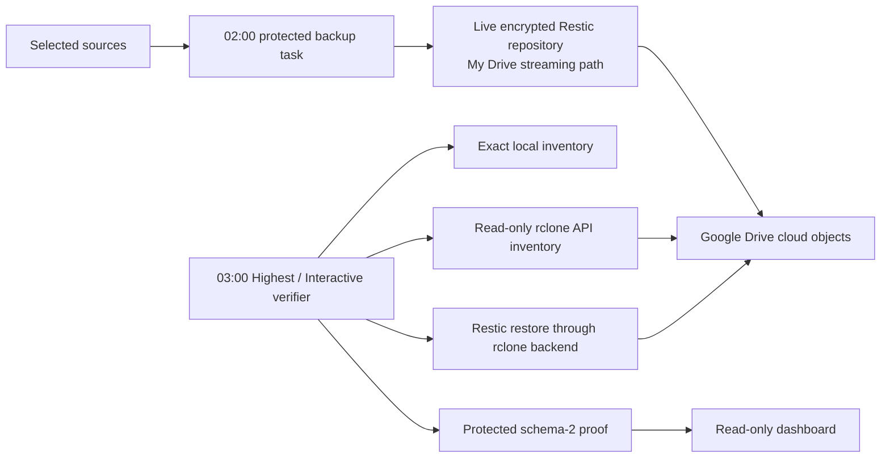

# Direct Google Drive repository verification

ResticBackuper supports one deliberately explicit Google Drive architecture:
the live encrypted Restic repository is a strict descendant of the Google Drive
for desktop **My Drive** streaming mount. Restic writes that repository through
DriveFS, and a separate elevated task verifies the same objects through the
Google Drive API. There is no second local mirror, ZIP, copy destination, or
promotion step.

This mode is useful when one repository path is the priority, but it is not an
offline copy. A synchronization mistake, account loss, provider outage, or an
attacker with access to the Drive account can still affect availability. Keep
the recovery key offline and maintain another independent backup when the data
matters.

## Data flow and trust boundaries



The backup and cloud-verification tasks share
`C:\ProgramData\ResticBackuper\run.lock`. Only Administrators and SYSTEM may
open that file. The verifier opens and byte-locks the existing file while
elevated; it does not change its ACL or the state ACL.
Consequently, a backup and a cloud inventory/restore cannot inspect and mutate
the repository concurrently.

The verifier never discovers executables or configuration through `PATH` or a
user-writable application-data directory. It accepts only:

- the manifest-hashed ResticBackuper runtime in
  `C:\Program Files\ResticBackuper`;
- `rclone.exe`, an encrypted rclone configuration, the CurrentUser-DPAPI
  configuration-password envelope, and the packaged password helper under
  `C:\ProgramData\ResticBackuperCloudVerification`; and
- a hash/length manifest for exactly those four cloud assets.

The cloud asset root is Administrators-owned, has protected inheritance, gives
SYSTEM and Administrators full control, and gives the scheduled user read and
execute access only when not elevated. Reparse points and unmanifested asset
names fail closed. Rclone receives a protected per-run configuration copy so an
OAuth token refresh cannot alter the immutable master configuration. The copy
is deleted when its run ends.

The task runs elevated, but Windows gives it the signed-in user's environment
variables, which any program the user runs can change. Rclone and Restic read
settings from them (an `RCLONE_CONFIG_<remote>_TYPE` can replace the backend
and run a program, a token variable can point the check at another account), so
the verifier passes none of them on. Every rclone, Restic and Python child gets
a fixed list: the Windows folders and processor values as Windows reports them,
Windows' own PowerShell module folder, temporary and rclone cache folders inside
the protected run folder (removed when the run ends), and, for rclone and
Restic only, the settings the verifier sets itself. The `drive.readonly` scope
and the My Drive root travel in rclone's connection string,
`ResticBackuperGoogleReadOnly,scope=drive.readonly,root_folder_id=root:<path>`,
which outranks both the configuration file and any `RCLONE_*` variable.

## What a successful verification proves

`verify_my_drive_cloud_repository.ps1` derives the API path from the exact live
repository path below the configured My Drive root. It then requires all of the
following:

1. The most recent `last-success.json` belongs to the active plan, configuration
   generation, repository ID, repository path, storage mode, and complete
   snapshot ID.
2. Local and API-backed `restic cat config` return the same complete repository
   ID.
3. Every local repository file has one case-sensitive API object match with the
   same byte length, MD5, SHA-256, and a provider object ID. Missing, extra,
   duplicate, hashless, unstable, or mismatched objects fail the run.
4. The direct-cloud Restic snapshot listing is a top-level JSON array whose
   every item has a unique complete identity and valid RFC3339Nano timestamp.
   Timestamps are ordered at full nanosecond precision after numeric offsets are
   normalized to UTC; the protected last-success snapshot must be among the
   newest timestamps.
5. Restic restores the protected canary from the complete snapshot ID through
   the `rclone:` backend with `--no-lock`, `--no-cache`, and `--verify`. It
   selects the canary's own folder (`<snapshot ID>:<folder>`), so only the
   canary lands in the protected run folder. Restoring the file with
   `--include` would also recreate each parent folder with its original owner
   and ACL, which the run folder's ACL check rejects.
6. The restored canary has the expected byte length and SHA-256, and nothing
   else was restored.

Native stdout and stderr are copied from process byte streams into protected
files. This avoids Windows PowerShell 5.1 text redirection changing JSON or
binary-sensitive output.

The immutable run proof is stored below:

```text
C:\ProgramData\ResticBackuperCloudVerification\runs\<run-id>\
```

The dashboard reads only the atomically replaced current proof:

```text
C:\ProgramData\ResticBackuperCloudVerification\evidence\latest-verification.json
```

It accepts only schema 2, post-activation, direct-cloud evidence. A new backup
attempt, plan or generation change, repository move, repository-ID change, or
new snapshot makes the old proof stale. Legacy local-mirror status cannot
produce a green off-site state.

## Waits, deadlines and failure records

The task starts at 03:00. When the PC is off, asleep or signed out then,
Windows starts it at the next sign-in or wake-up, often before Google Drive
for desktop and the network are back, and together with the backup Windows
starts to make up for the same night. So the verifier first waits, within
limits, for what it needs:

1. Google Drive for desktop's folder and the repository in it, up to 30
   minutes.
2. A network that can look up Google Drive's address, up to 15 minutes. Only
   the DNS lookup is made (each one for at most 10 seconds); nothing is sent
   to Google.
3. A due or missed backup. While the latest backup started more than 20 hours
   earlier, the check gives a backup up to 15 minutes to start first.
   Meanwhile it reads only the backup's `status.json` and does not try the run
   lock: the backup takes the lock without waiting and gives up until the next
   night if it is held.
4. The run lock, which a running backup holds, up to 6 hours. Only a lock
   violation counts as held; any other error opening the lock stops the check.

Each Restic, rclone and Python step then has a deadline sized from the
repository, measured from its folder listing alone: a fixed allowance plus one
second per file for the Google Drive listing, 2 MiB/s for the inventory helper
(which reads every repository file through Google Drive for desktop, which
downloads it) and 32 MiB/s for the direct-cloud restore. If the listing fails,
the deadlines are not sized and each step may use the rest of the check's
time. No Restic, rclone or Python step runs past 11 hours after the check
started, before Task Scheduler's own 12-hour limit; one stopped there is
recorded as out of time.
A step that runs past its deadline is stopped together with every process it
started (Restic starts rclone), each by its exact process ID and start time.

Before any long step, the verifier runs `rclone version` and refuses rclone
older than 1.65.0, the first release that reports Google Drive's SHA-256
checksums. The proof records the version, and `rclone_scope_requested`
(`drive.readonly`) with `rclone_token_scope_verified: false`: the scope is
requested on every call, but the verifier does not find out what the stored
token was granted when it was created (see below).

When a check stops for any reason after its evidence folder has passed its
permission check (the first thing it does), it replaces
`evidence\latest-failure.json`:

```json
{
  "schema_version": 1,
  "record_kind": "direct_my_drive_cloud_check_failure",
  "state": "failed",
  "run_id": "20261110T030001123Z-1a2b3c4d",
  "started_utc": "2026-11-10T03:00:01.1234567Z",
  "failed_utc": "2026-11-10T03:02:11.1234567Z",
  "step": "listing_google_drive",
  "step_label": "listing your backup's files in Google Drive",
  "reason_code": "google_drive_list_failed",
  "reason": "Rewindle couldn't list your backup's files in Google Drive.",
  "next_step": "Make sure this PC is online overnight. Rewindle checks again tonight.",
  "technical_detail": "Direct Google Drive inventory failed closed with exit code 1. ...",
  "plan_id": "<plan GUID, or null before the plan was read>",
  "config_generation": 3
}
```

The steps are `checking_setup`, `waiting_for_google_drive`,
`waiting_for_network`, `waiting_for_backup`, `checking_latest_backup`,
`checking_rclone`, `opening_local_backup`, `connecting_to_google_drive`,
`listing_google_drive`, `comparing_files`, `listing_cloud_backups`,
`test_restore` and `saving_result`. A check that passes deletes the record
after it writes the new proof. Should that deletion fail, the record is older
than the proof, so a reader should trust it only when its `failed_utc` is later
than the proof's `verified_utc`. The task itself still ends with an error, as
before.

Every run keeps its own folder under `runs\` (its proof, native logs and the
restored canary). After the start-of-run permission check of the whole tree,
the verifier keeps the folders of the four runs before it (with its own, five)
and the one that holds the latest proof, and removes the others, so that check
stays short. Removing is best effort: a file still in use stays until a later
run, and never stops the check.

## Provision the verification task

First install ResticBackuper with `google_drivefs_stream`, run one real backup,
and confirm that it succeeds. The live repository must be below the configured
My Drive streaming root; for example:

```text
G:\My Drive\ResticBackups\Personal
```

Install a reviewed Windows x64 rclone build, 1.65.0 or later, separately:
the check compares Google Drive's SHA-256 checksums, which earlier versions do
not report. Provisioning runs `rclone version` on the protected copy (without
a window, and stops it after a minute), refuses an older build, and records
the version in `assets-manifest.json` as `rclone_version`. Create a dedicated
Google Drive remote named `ResticBackuperGoogleReadOnly` and authorize it with
the `drive.readonly` scope from the beginning. The verifier forces the
read-only backend option and My Drive root for every invocation, but it cannot
retroactively reduce the OAuth grant of a token that was originally issued
with broader access.

Create the remote in a temporary configuration file and encrypt the whole
configuration with `rclone config encryption set`. Do not confuse encrypted
configuration with rclone's reversible `obscure` encoding.

Store the rclone configuration password as a `PSCredential` DPAPI envelope.
Run this as the same Windows user that owns the backup task:

```powershell
$credentialSource = Join-Path $env:TEMP 'rclone-config-password.clixml'
$configurationPassword = Read-Host `
  'Rclone configuration password' `
  -AsSecureString
$credential = [PSCredential]::new(
  'rclone-config',
  $configurationPassword
)
$credential | Export-Clixml -LiteralPath $credentialSource
Remove-Variable credential, configurationPassword
```

Never put the plaintext value in a command argument, script, log, or task
definition.

From a same-user elevated Windows PowerShell 5.1 session, provision the assets
and register the verification-only task:

```powershell
$runtime = 'C:\Program Files\ResticBackuper'
$rcloneExe = 'C:\Path\To\Reviewed\rclone.exe'
$rcloneConfig = 'C:\Path\To\Encrypted\rclone-readonly.conf'
$credentialSource = Join-Path $env:TEMP 'rclone-config-password.clixml'
$rcloneExeHash = (
  Get-FileHash $rcloneExe -Algorithm SHA256
).Hash.ToLowerInvariant()
$rcloneConfigHash = (
  Get-FileHash $rcloneConfig -Algorithm SHA256
).Hash.ToLowerInvariant()
$credentialHash = (
  Get-FileHash $credentialSource -Algorithm SHA256
).Hash.ToLowerInvariant()

$powershell = Join-Path $env:SystemRoot 'System32\WindowsPowerShell\v1.0\powershell.exe'
& $powershell -NoProfile -ExecutionPolicy Bypass `
  -File (Join-Path $runtime 'install_google_drive_sync_task.ps1') `
  -ProvisionAssets `
  -RcloneExecutableSource $rcloneExe `
  -RcloneConfigSource $rcloneConfig `
  -RcloneCredentialSource $credentialSource `
  -ExpectedRcloneExecutableSha256 $rcloneExeHash `
  -ExpectedRcloneConfigSha256 $rcloneConfigHash `
  -ExpectedRcloneCredentialSha256 $credentialHash
```

The task installer runs in a new Windows PowerShell process, without your
profile or the modules this session loaded, and loads modules only from
Windows' own folder.

The password helper is always copied from the manifest-authorized Program Files
runtime; an arbitrary helper is rejected. Independently compare the rclone
executable hash with the checksum published for the build you reviewed before
running the command. When a release ships a changed helper, registering the
task again needs `-ProvisionAssets` and the three sources above; without them
the task installer stops with "Protected rclone assets do not contain the
packaged password helper".

For compatibility with installations that used the earlier mirror experiment,
the default task name remains `ResticBackuperGoogleDriveSync`. Its installed
action is now verification-only: daily at 03:00, `InteractiveToken`, Highest,
`IgnoreNew`, and `StartWhenAvailable`. Installation does not start it and never
copies, deletes, prunes, or modifies repository objects.

The action starts the task launcher from the program folder:
`ResticBackuperTaskLauncher.exe --google-drive-check --expected-repository-id
<repository ID>`. The launcher runs the verifier in Windows PowerShell without
a window, with Windows' own environment values only (Windows' module folder,
and Windows' `Temp` folder for temporary files), in a job that ends the
verifier and every program it started when the launcher ends. It takes the
verifier and the configuration from its own program folder and the evidence
folder from Windows, and accepts nothing but a repository ID of 64 lowercase
hexadecimal digits. A task registered by an earlier version starts
`powershell.exe` itself, which shows a console window for a moment at every
run; registering the task again replaces it with the launcher.

After the task completes, inspect Task Scheduler and the dashboard. A successful
task is not enough by itself: the dashboard must show **Google Drive repository
verified**, with an API-confirmed exact inventory and independent direct-cloud
restore bound to the latest successful backup.

## Operational limitations

- The task needs the installing user to be signed in because both Restic and
  rclone credentials use CurrentUser DPAPI and an interactive token.
- This verifier supports the explicit My Drive streaming repository mode only.
  A `local_ntfs` repository needs a separately designed off-site system.
- Rclone and Restic ignore your own `RCLONE_*`, `RESTIC_*` and proxy
  variables (`HTTP_PROXY`, `HTTPS_PROXY`, `NO_PROXY`) during the check. A PC
  that reaches Google only through a proxy set in those variables cannot run
  it.
- Updating rclone, changing its encrypted configuration, rotating the
  configuration password, changing accounts, or changing the remote requires a
  reviewed reprovisioning procedure. Existing protected assets are never
  silently overwritten.
- An exact API inventory and direct restore prove that the verified encrypted
  repository generation was readable from Google Drive at that time. They do
  not make the provider account immutable or offline.
- A destructive-change anomaly still requires exact operator acknowledgement
  before future deletion or retention work. That review does not pause DriveFS
  upload because the sole repository is already live below the streaming mount.
